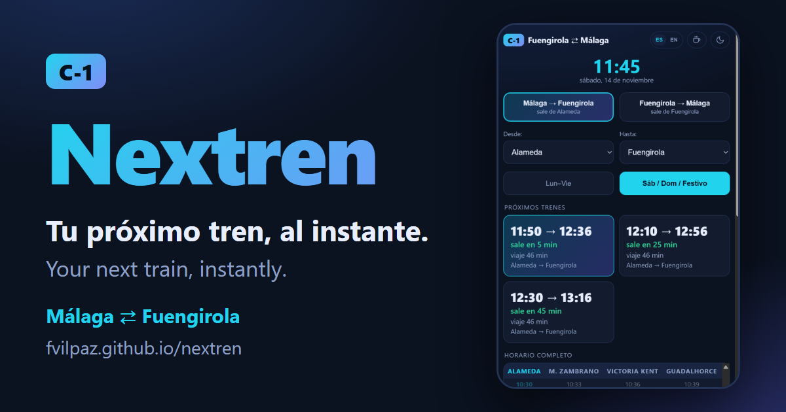

# Nextren · Horario de la C-1

> Tu próximo tren, al instante. · [English version](README.md)

**Nextren** te dice cuándo sale el próximo tren de Cercanías **C-1** entre dos paradas cualesquiera de la línea Málaga ⇄ Fuengirola, a qué hora llega y cuánto dura el viaje. La abres y la respuesta ya está: sin buscar en la web del operador, sin escribir origen y destino en una app de mapas.

🚆 **[Abrir la app](https://fvilpaz.github.io/nextren/)** · instalable en el móvil (PWA), gratis y sin registro.



## Qué hace
- **Los próximos 3 trenes** de tu trayecto, con hora de salida, de llegada, duración del viaje y cuenta atrás.
- **Cualquier origen y destino** entre las 17 paradas, en los dos sentidos (el sentido se deduce solo).
- **Horario completo** debajo, con tus dos paradas resaltadas.
- Elige el horario correcto para **laborables y fines de semana/festivos**, y avisa en los festivos de que lo compruebes.
- Tema **claro / oscuro** e idioma **español / inglés**. Recuerda lo que elijas.
- Funciona **sin conexión** tras la primera visita.

## Cómo funciona
Sin servidor, sin base de datos y sin librerías: HTML, CSS y JavaScript puros en GitHub Pages. Solo se guardan las **salidas de cabecera** y un **desfase fijo en minutos por parada**; todas las horas que se ven se calculan a partir de eso.

| Archivo | Qué hace |
|---|---|
| `app.js` | Paradas, salidas y lógica de la pantalla |
| `festivos.js` | Festivos de Andalucía 2026–2027 (BOJA) |
| `i18n.js`, `theme.js` | Idioma y tema |
| `sw.js`, `manifest.webmanifest` | PWA: sin conexión e instalación |
| `docs/datos-y-fuentes.md` | De dónde salen las horas y qué está verificado |

## Límites (los honestos)
- Es un **horario teórico**: no incluye retrasos, obras ni cancelaciones.
- Solo la **línea C-1** por ahora.
- Los festivos son los **autonómicos**; no incluye los locales.
- Las salidas vienen del [Consorcio de Transportes de Málaga](https://siu.ctmam.ctan.es/es/movil/horarios_lineas_tabla.php?linea=160); las paradas intermedias, de [Renfe Cercanías Málaga](https://www.renfe.com/es/es/cercanias/cercanias-malaga/horarios).

## Probarla en local
```bash
python -m http.server 8000   # y abre http://localhost:8000
```
(El service worker necesita `localhost` o HTTPS: abrir el archivo directamente no activa el modo sin conexión.)

---
De **Fernando Vilas Paz** · [GitHub](https://github.com/fvilpaz) · [CV](https://fvilpaz.github.io/cv/)
