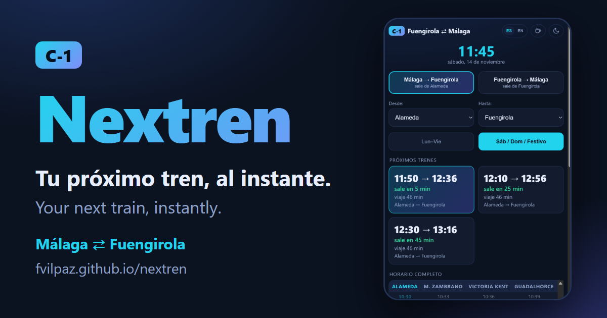

# Nextren · C-1 train timetable

> Your next train, instantly. · [Versión en español](README.es.md)

**Nextren** shows when the next Cercanías **C-1** train leaves between any two stops of the Málaga ⇄ Fuengirola line (Spain), when it arrives and how long the trip takes. Open it and the answer is already there: no searching the operator's site, no typing origin and destination into a maps app.

🚆 **[Open the app](https://fvilpaz.github.io/nextren/)** · installable on your phone (PWA), free, no sign-up.



## Features
- **Next 3 trains** for your route, with departure time, arrival time, trip duration and a countdown.
- **Any origin and destination** among the 17 stops, in either direction (the direction is worked out for you).
- **Full timetable** below, with your two stops highlighted.
- Picks the right timetable for **weekdays and weekends/holidays**, and warns you on public holidays to double-check.
- **Light / dark** theme and **English / Spanish**. Your choice is remembered.
- Works **offline** after the first visit.

## How it works
No server, no database, no libraries: plain HTML, CSS and JavaScript on GitHub Pages. The app stores only the **terminus departure times** and a **fixed offset in minutes per stop**; every time shown is computed from those.

| File | What it does |
|---|---|
| `app.js` | Stops, departures and the screen logic |
| `festivos.js` | Andalusian public holidays 2026–2027 (BOJA) |
| `i18n.js`, `theme.js` | Language and theme |
| `sw.js`, `manifest.webmanifest` | PWA: offline and installation |
| `docs/datos-y-fuentes.md` | Where the times come from and what has been verified (Spanish) |

## Limits (honest ones)
- It is a **theoretical timetable**: no delays, works or cancellations.
- Only the **C-1 line** for now.
- Holidays are the **regional** ones; local holidays are not included.
- Departures come from the [Consorcio de Transportes de Málaga](https://siu.ctmam.ctan.es/es/movil/horarios_lineas_tabla.php?linea=160); the intermediate stops from [Renfe Cercanías Málaga](https://www.renfe.com/es/es/cercanias/cercanias-malaga/horarios).

## Run it locally
```bash
python -m http.server 8000   # then open http://localhost:8000
```
(Service workers need `localhost` or HTTPS, so opening the file directly won't enable offline mode.)

---
By **Fernando Vilas Paz** · [GitHub](https://github.com/fvilpaz) · [CV](https://fvilpaz.github.io/cv/)
